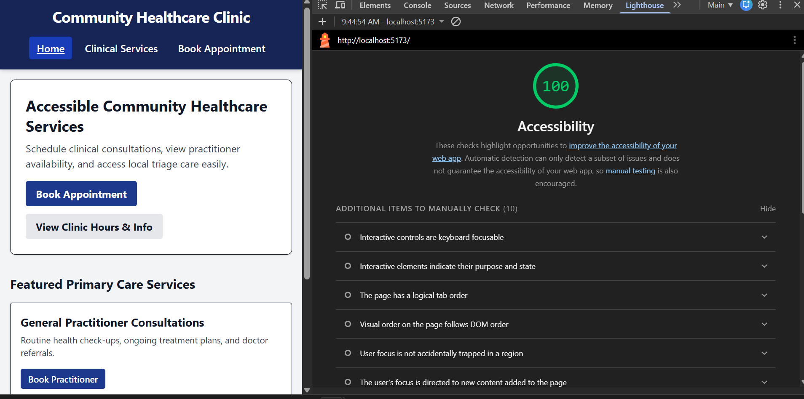

# Community Healthcare Clinic

## Overview
An accessible web application for a local healthcare clinic built using React, Vite, and Tailwind CSS. The app follows WCAG 2.1 AA accessibility guidelines to ensure easy navigation for screen readers and keyboard users.

## Architectural & Accessibility Decision Write-Up 

###  1. Accessibility Trade-Off Analysis
- **Native HTML Controls vs. Custom Styling:** Custom dropdowns and select inputs were avoided in favor of standard `<select>` and `<button>` elements styled with Tailwind utilities.
While custom ARIA listboxes offer total design freedom, they often break native screen reader behaviors on mobile devices. Choosing native HTML controls guaranteed full keyboard accessibility out of the box without extra JS polyfills.
- **Modal Focus Lock vs. Free Page Navigation:** The modal dialog traps focus internally while open, temporarily blocking access to the background layout. This trade-off prevents keyboard users from accidentally tabbing out of the open modal into hidden page content, which can cause severe disorientation. Focus returns directly to the triggering button once closed.
- **Live Region Verbosity vs. Notification Delays:** The appointment form uses `aria-live="polite"` instead of `aria-live="assertive"`. Assertive live regions interrupt screen reader speech immediately, which can cut off important field labels while a user is typing. Using polite announcements ensures screen readers finish speaking the current line before announcing submission updates.

### 2. Assistive Tech State Architecture
    React state directly synchronizes with the browser Accessibility Tree to reflect real-time UI changes:
- **Navigation State (`activeTab`):** Drives the active navigation state in `App.jsx`. The active tab updates dynamically with `aria-current="page"`, letting assistive tech identify the current view.
- **Filter State (`isFilterOpen` and `selectedSpecialty`):** Toggling the filter accordion updates `aria-expanded={isFilterOpen}` on the control button. Selecting a specialty updates `aria-pressed` on the category buttons, communicating toggle state directly to the Accessibility Tree.
- **Form State & Notifications (`touched` and `announcement`):** Input validation state maps to `aria-invalid`. Validation errors update `aria-describedby` dynamically to point to error message IDs. Form submission messages update an `aria-live="polite"` container to announce status changes without shifting keyboard focus.
- **Programmatic Focus Management (`modalRef`):** `Modal.jsx` tracks the previously focused element using `useRef`. When opened, focus shifts into the dialog using `ref.current.focus()`. When closed, focus returns to the original button.

### 3. Verification & Testing Audit

#### Manual Testing Logs
- **Keyboard Tab-Sequence Testing:** Verified complete tab loop through the top skip link (`href="#main-content"`), header navigation, landing page buttons and footer. Confirmed no visual focus indicators are clipped or hidden.
- **Screen Reader Verification (NVDA):** Successfully navigated all views using NVDA on desktop. Verified that active tabs announce as "current page", accordion state updates announce expanded/collapsed status and form errors read out when fields lose focus.
- **Screen Reader Verification (VoiceOver):** Tested modal flow in Safari using VoiceOver (`VO + Keys`). Confirmed that background content is hidden from screen readers while the modal is active and that pressing `Escape` closes the dialog cleanly.

#### Automated Audit Results
- **Lighthouse Accessibility Score:** 100 / 100
- #### **Lighthouse Report:**
    

## How To Run Project

1. Clone the github repo using `git clone https://github.com/richardcodez/booking_portal_app`
2. ```Bash
    cd booking_portal_app
    cd accessibility-app
    npm install
    npm run dev
    ```
3. Open your browser and go to http://localhost:5173